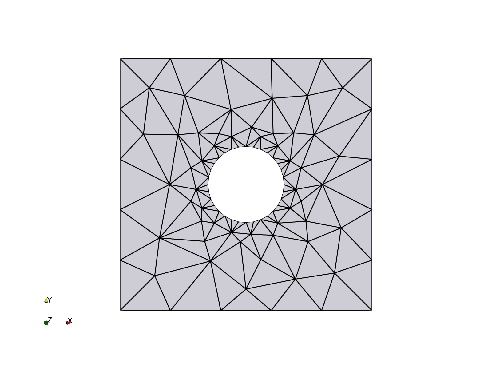
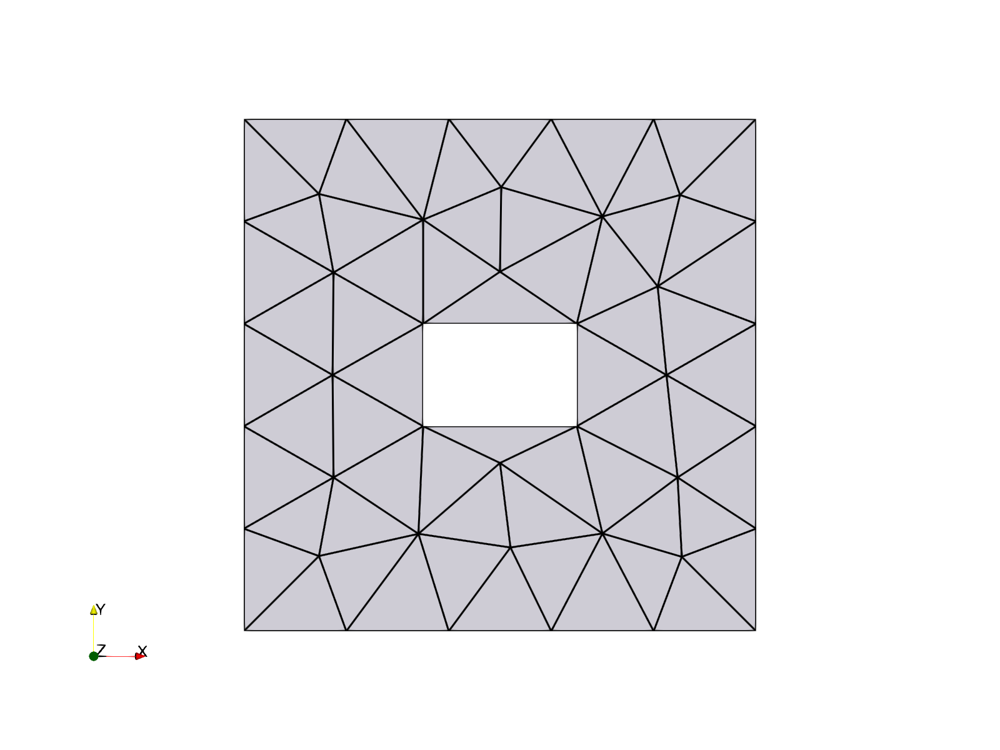

# unstructured-mesh-writer
A writer of 2D Triangular and 3D Tetrahedral unstructured meshes

Two writers produce the same HDF5/XDMF schema:

- `writer.py` (Python, MeshPy for `triangle` and `tetra`): `python writer.py config.yaml` or `python writer.py configs_dir/`.
- `writer.jl` (Julia, no mesher library; Delaunay refinement is built in): `julia writer.jl config.yaml` or `julia writer.jl configs_dir/`. It needs the packages YAML and HDF5.

Both write `<name>.h5` and `<name>.xdmf` next to the config. The mesh types are
`gridsplit`, `equilateral` (2-D), `kuhn` (3-D), `triangle` and `tetra` (Delaunay, with obstacles).
The header of each writer lists the config keys. The 2-D `diagonal` names are
`backslash` (default), `slash` and `alternate` in both writers.

## HDF5 schema

All matrices are row-major, with the shape (N, k) that XDMF, `h5py` and ParaView expect.
Connectivity is 0-based. In Julia, load a dataset with `_read_ds` to get the array back as `(N, k)`.

| Dataset | Shape | Content |
|---|---|---|
| `points` | (nVertices, 3) | Vertex coordinates (z is 0 in 2-D). |
| `cell_to_vertex` | (nCells, 3 or 4) | Vertices of each cell, positively oriented in 2-D. |
| `cell_to_edge` | (nCells, 3 or 6) | Edges of each cell. |
| `vertex_to_vertex` | (nEdges, 2) | Edge end vertices, smaller first. |
| `vertex_to_cell/offsets`, `.../indices` | (nVertices+1), (nIndices) | Cells around each vertex, in CSR form. |
| `cell_vol`, `vertex_vol` | (nCells), (nVertices) | Cell and dual vertex measures. |
| `cell_vertex_normal` | (nCells, dim+1, 3) | Normal of the face opposite each local vertex. |
| `boundary/point_markers` | (nVertices) | Box side or obstacle marker, 0 inside. |
| `boundary/edge_markers` | (nEdges) | The same for edges; 2-D only. |
| `periodicity/*_pairs`, `all_pairs` | (nPairs, 2) | Periodic vertex pairs; only for periodic axes. |

Attributes: `mesh_type` (`triangle` for every 2-D mesh, `tetra` for every 3-D mesh), `dimension`,
`box_length`, `n_vertices`, `n_cells`, `n_edges`.

## Tests

`julia test_writer.jl [writer.jl]` runs the unit, config, end-to-end and gallery tests of `writer.jl`.
With `WRITER_REF_DIR=<folder>` it also compares the output with stored reference outputs bit by bit.
Make such a folder with `tools/run_writer_on_configs.sh writer.jl <folder>`. See `tools/README.md` for the other tools.

## Gallery

### Triangle

| | |
|---|---|
|  <b>triangle_plain</b> |  <b>triangle_circle</b> |
|  <b>triangle_rectangle</b> | |

### Tetra

| | |
|---|---|
|  <b>tetra_plain</b> | |

### Equilateral

| | |
|---|---|
|  <b>equilateral_plain</b> | |

### Gridsplit

| | |
|---|---|
|  <b>gridsplit_backslash</b> |  <b>gridsplit_slash</b> |
|  <b>gridsplit_alternate</b> |  <b>gridsplit_stretched_onesided</b> |
|  <b>gridsplit_stretched_symmetric</b> | |

### Kuhn

| | |
|---|---|
|  <b>kuhn_main</b> |  <b>kuhn_flip_x</b> |
|  <b>kuhn_flip_y</b> |  <b>kuhn_flip_z</b> |
|  <b>kuhn_alternate_layers</b> |  <b>kuhn_stretched_onesided</b> |
|  <b>kuhn_stretched_symmetric</b> | |
