# unstructured-mesh-writer
A writer of 2D Triangular and 3D Tetrahedral unstructured meshes

Two writers produce the same HDF5/XDMF schema:

- `writer.py` (Python, MeshPy for `triangle` and `tetra`): `python writer.py config.yaml` or `python writer.py configs_dir/`.
- `writer.jl` (Julia, no mesher library; Delaunay refinement is built in): `julia --project=. writer.jl config.yaml` or `julia --project=. writer.jl configs_dir/`.

Both write `<name>.h5` and `<name>.xdmf` next to the config. The mesh types are
`gridsplit`, `equilateral` (2-D), `kuhn` (3-D), `triangle` and `tetra` (Delaunay, with obstacles).
The header of each writer lists the config keys. The 2-D `diagonal` names are
`backslash` (default), `slash` and `alternate` in both writers.

## HDF5 schema

All matrices are row-major, with the shape (N, k) that XDMF, `h5py` and ParaView expect.
Connectivity is 0-based. In Julia, load a dataset with `_read_ds` to get the array back as `(N, k)`.

| Dataset | Shape | Content |
|---|---|---|
| `points` | (nVertices, 3) | Vertex coordinates (z is 0 in 2-D). |
| `cell_to_vertex` | (nCells, 3 or 4) | Vertices of each cell, positively oriented in 2-D. |
| `cell_to_edge` | (nCells, 3 or 6) | Edges of each cell. |
| `vertex_to_vertex` | (nEdges, 2) | Edge end vertices, smaller first. |
| `vertex_to_cell/offsets`, `.../indices` | (nVertices+1), (nIndices) | Cells around each vertex, in CSR form. |
| `cell_vol`, `vertex_vol` | (nCells), (nVertices) | Cell and dual vertex measures. |
| `cell_vertex_normal` | (nCells, dim+1, 3) | Per cell and local vertex, the area vector of the face opposite that vertex. Not summed onto global vertices. |
| `boundary/point_markers` | (nVertices) | Box side or obstacle marker, 0 inside. |
| `boundary/edge_markers` | (nEdges) | The same for edges; 2-D only. |
| `periodicity/*_pairs`, `all_pairs` | (nPairs, 2) | Periodic vertex pairs; only for periodic axes. |

Attributes: `schema_version` (1: row-major matrices, 0-based connectivity; it increases when a layout or a meaning changes), `mesh_type` (`triangle` for every 2-D mesh, `tetra` for every 3-D mesh), `dimension`,
`box_length`, `n_vertices`, `n_cells`, `n_edges`.

Quality attributes (floats, angles in degrees; both writers compute them the same way and log them):

| Mesh | Attributes |
|---|---|
| 2-D | `min_angle_deg`, `max_angle_deg`: the smallest and the largest interior angle of the triangles |
| 3-D | `min_dihedral_deg`, `max_dihedral_deg`: the smallest and the largest dihedral angle of the tetrahedra; `max_radius_edge_ratio`: the largest ratio of circumradius to shortest edge (0.612 for a regular tetrahedron) |

Adding attributes does not change `schema_version`.

### Sliver removal in `writer.jl` (`tetra` only)

After the Delaunay refinement, `writer.jl` flips faces and edges around the cells whose smallest dihedral angle is below the goal.
A flip changes the connectivity of 2 or 3 cells and moves no vertex. The boundary, the markers and the periodic pairs do not change.
The key `mesh_options: min_dihedral` sets the goal in degrees. The default is 10.0. The value 0 turns the flips off.
The goal is not a guarantee. The log lists, for each pass, the flips done and the candidates rejected, and the number of cells below the goal before and after. A `[warn]` line appears when cells stay below the goal.
A flip is kept only when the new cells fill the same space with a positive volume, the smallest dihedral angle rises by at least 1 degree,
and the radius-edge ratio stays within the larger of the old ratio and `radius_edge_bound`. The smoothing sweeps run after the flips.
In the 10 reference `tetra` meshes the number of cells below 10 degrees fell from 210 to 4. `writer.py` has no such step.

The key `mesh_options: max_dihedral` sets a goal for the largest dihedral angle, in degrees. The value must be 0 (off, the default) or in [90, 180). The flip pass uses the goal in the same way as `min_dihedral`.
A cell is a candidate when it is below the first goal or above the second goal. A flip must raise the smaller of the two margins of the cells it replaces by at least 1 degree.
The smoothing sweeps do not make the largest angle worse. The log gives the number of cells above the goal before and after the flips, and a `[warn]` line when cells stay above it.
The value 150 is a good choice. Without the goal, the 10 reference `tetra` meshes have 1 to 10 cells above 160 degrees and a largest angle of 161 to 169 degrees. With the goal 150:

| Result | Without `max_dihedral` | With `max_dihedral: 150` |
|---|---|---|
| Meshes with no cell above 160 degrees | 0 of 10 | 9 of 10 |
| Largest angle | 161.2 to 169.2 degrees | 144.9 to 162.2 degrees |
| Smallest angle | 7.4 to 12.0 degrees | 8.5 to 21.1 degrees |
| Number of cells | reference | 1 to 3 percent fewer |

The mesh `tet_per_ftt` (periodic in `y` and `z`) keeps 2 cells above 160 degrees. A second flip pass after the smoothing sweeps flips at most 2 cells per mesh at the goal 150. The writer does not run this pass.

## Loading a mesh into kernels (`writer.jl`)

`load_mesh(path)` reads a `.h5` file of either writer and returns a `NamedTuple` with the layout that the kernels expect.
Matrices have the shape `(N, k)`. Every vertex, cell and edge number is 1-based. The file keeps them 0-based.

```julia
include("writer.jl")
m = load_mesh("tet_box.h5")
m.pts      # (N, 3) Float64
m.cells    # (nCells, 4) Int, 1-based
m.c2e      # (nCells, 6) Int, 1-based
meas = zeros(size(m.cells, 1))
signed_measure_3d_kernel(m.cells, m.pts, size(m.cells, 1), meas)
```

The other fields are `edges`, `cellVol`, `cvn`, `vertexVol`, `v2cOff` and `v2cIdx`, `ptMk`, `edgeMk` (2-D only), `periodic`, `perPairs`, `allPairs`, `obstacles`, `quality`, `dim`, `meshType`, `boxLength` and `schemaVersion`.
The cells of vertex `v` are `v2cIdx[v2cOff[v]:v2cOff[v+1]-1]`. The function stops with an error when `schema_version` is not 1.

## Mesh hierarchies (`writer.jl`)

A config with the key `hierarchy` makes a list of nested meshes for geometric multigrid. You give the coarsest mesh and the number of levels. The writer refines the coarsest mesh again and again.
The writer does not build transfer operators. It writes each level as a normal mesh file and the relation between two levels as two integer arrays. Your kernels can be finite element, vertex-centered finite volume or cell-centered. They build their own operators from the arrays.

```yaml
mesh_type: tetra
box_length: [1.0, 1.0, 1.0]
mesh_options:
  mesh_size: 0.5
  mesh_size_obstacle: 0.1
obstacles:
  - shape: sphere
    center: [0.5, 0.5, 0.5]
    radius: 0.2
hierarchy:
  levels: 3          # required: the number of levels, coarsest included
  boundary: frozen   # the only value for now
  max_cells: 2000000 # limit on the cells of the finest level (default)
```

- **Levels.** Level 0 is the coarsest mesh. It is the mesh that the other keys describe, and it is the same mesh as without `hierarchy`. Level k comes from k refinements.
- **Refinement.** A triangle gives 4 triangles. A tetrahedron gives 8 tetrahedra (the method of Bey). Every mesh type works, also the stretched and the `alternate` grids.
- **Files.** The files are `<stem>_L0.h5`, `<stem>_L1.h5` and so on, each with an XDMF file. A config without `hierarchy` writes `<stem>.h5`.
- **Provenance.** Level 0 holds the writer source in its XDMF file. The other levels hold the YAML text, the log and a pointer to level 0.
- **Size.** Each level has 4 (2-D) or 8 (3-D) times the cells of the level before. The writer stops with an error, before it refines, when the finest level would have more than `max_cells` cells.

### The relation between two levels

Every level file has the group `/hierarchy` with the attributes `level`, `n_levels`, `refinement` (`red`), `boundary` and `children_per_cell`.
A file of level 1 or higher also has two 0-based datasets:

| Dataset | Shape | Meaning |
|---|---|---|
| `fine_vertex_parents` | (n_vertices, 2) | A vertex of the coarse mesh holds its own number twice. A midpoint holds the two ends of its coarse edge. |
| `cell_parent` | (n_cells) | The coarse cell of each cell. |

The order is fixed:
- The fine vertices 1 to nV are the coarse vertices, in the same order.
- The midpoint of coarse edge e is fine vertex nV + e. The coarse edge array gives the order.
- The children of coarse cell k are the rows c (k - 1) + 1 to c k. The number c is 4 in 2-D and 8 in 3-D.

`load_mesh` returns the field `hierarchy` (`nothing` for a plain mesh). `load_hierarchy(yamlPath)` reads all levels, coarsest first.
The next example is not a feature of the writer. It shows how a kernel can read the arrays. It interpolates a nodal field to the next finer level and ran as written:

```julia
include("writer.jl")
main("gallery_hierarchy/hier_triangle_circle.yaml")
levels = load_hierarchy("gallery_hierarchy/hier_triangle_circle.yaml")
coarse, fine = levels[1], levels[2]
vp = fine.hierarchy.vertexParents       # (nFine, 2), 1-based coarse vertices
uC = coarse.pts[:, 1]                    # a coarse nodal field
uF = zeros(size(fine.pts, 1))
for v in 1:size(uF, 1)
    uF[v] = 0.5 * (uC[vp[v, 1]] + uC[vp[v, 2]])
end
cp = fine.hierarchy.cellParent           # (nFineCells,), 1-based coarse cells
```

### Boundary of curved obstacles

The value `frozen` is the only one for now. The new boundary vertices are edge midpoints. An obstacle keeps the polygon (2-D) or polyhedron (3-D) of level 0 on every level.
The hierarchy is exactly nested. The volume is the same on every level. The writer needs no code for each obstacle shape, so new shapes will work.
The consequence is that the finest level does not follow a circle or a sphere better than level 0. The log shows the share of the obstacle volume that the mesh captures:

```
obstacle volume captured by the mesh: 96.62 percent of 0.0335103
```

A circle with 12 segments captures 95.5 percent, and a regular 8-gon captures 90.0 percent. The writer writes `[warn] hierarchy:` at level 0 when the share is below 95 percent. This threshold is my choice. A box or a rectangle is captured completely.
A boundary that moves onto the true shape (`projected`) is possible, but it needs a closest-point function for each shape. It is not built.

### Quality on the fine levels

No flip and no smoothing run on a fine level, because either one would break the nesting. The quality of level 0 therefore sets the bound.
- **2-D.** The 4 children of a triangle are similar to the parent. Every level has the angles of level 0.
- **3-D.** The 4 corner children are similar to the parent. The 4 children in the middle depend on the diagonal of the octahedron. The writer tests the 3 diagonals for each cell. It keeps the one whose worst interior child has the best mean-ratio shape (a max-min rule, after Liu and Joe, *Math. Comp.* 65, 1996). A poor rule can degrade the shape without limit.
- **Measured here** (one run for each case, with `tools/hierarchy_quality.jl`):

| Mesh | Smallest dihedral angle, max-min rule | With one fixed diagonal |
|---|---|---|
| `kuhn`, all 5 diagonal modes, 4 levels | 45.0 degrees on every level | 15.8 to 18.4 degrees at level 3 |
| `tetra` box, 4 levels | 12.87 degrees on every level | 3.0 to 5.1 degrees at level 3 |
| `tetra` with a sphere, 3 levels | 10.9 degrees on every level | 5.4 to 6.7 degrees at level 2 |
| `tetra` with a sphere and a box, 3 levels | 10.1, 10.1, 9.52 degrees | 4.9 to 6.2 degrees at level 2 |

- **Radius-edge ratio.** It grows at level 1 (for example from 1.12 to 2.44 on the `tetra` box) and then stays constant in these runs. The option `radius_edge_bound` applies to level 0 only.
- **Slivers.** A sliver of level 0 stays on every level. The flip pass (`min_dihedral`) runs on level 0, before the refinement.

### Check a hierarchy with a multigrid solver

The script `tools/hierarchy_multigrid_check.jl` reads the level files with `load_hierarchy`, like a solver does, and uses only the stored arrays. It makes three checks:

1. The prolongation matrix `P` copies every linear function from level `k` to level `k+1`. The script builds `P` from `fine_vertex_parents`: each fine vertex gets the weight 0.5 from each of its two parents.
2. The Galerkin product `P' * A_fine * P` equals the stiffness matrix `A_coarse` of the Laplace operator that the script assembles on the coarse mesh. This is true only when the coarse space lies inside the fine space, so one number tests the nesting, the vertex order and the cell order.
3. A V(2,2)-cycle with Gauss-Seidel smoothing and a direct solve on level 0 solves a Poisson problem with zero values at the vertices that have a boundary marker.

Measured here (`julia --project=. tools/hierarchy_multigrid_check.jl`): the errors of checks 1 and 2 are between 1e-16 and 6e-15 on all levels of the 4 test hierarchies (2-D with a circle, 2-D stretched grid, `kuhn` box, `tetra` with a sphere).
The convergence factor of the V-cycle, for a hierarchy with level 0 and 1 to 4 finer levels:

| Hierarchy | Factor, 1 finer level | 2 | 3 | 4 |
|---|---|---|---|---|
| `triangle` with a circle | 0.08 | 0.11 | 0.12 | 0.15 |
| `gridsplit` stretched (1.3 and 1.5) | 0.13 | 0.25 | 0.29 | 0.34 |
| `kuhn` box | 0.06 | 0.16 | 0.21 | |
| `tetra` with a sphere (`max_dihedral: 150`) | 0.34 | 0.44 | 0.54 | |

The factor grows a little with the number of levels, and it grows most on the `tetra` mesh. The cause is the smoother and the quality of the coarse mesh, not the hierarchy: check 2 shows that the coarse matrices are exact. A stronger smoother or a better coarse mesh lowers the factor.
A hierarchy with a wrong vertex order gives a failure in check 1 and check 2. The script ends with a code 1 when a check fails or when a factor is 0.7 or more. The test suite runs the script on 2 of the hierarchies.

### Choosing the coarsest mesh

- **Size.** A direct solver should be able to handle the coarsest mesh. COMSOL uses this rule. PETSc GAMG gives 1000 equations as an example limit. The best number depends on your solver.
- **Geometry.** The coarsest mesh must resolve the obstacles. Use at least 12 segments on a circle. With `frozen`, the finest level has the same boundary as level 0.
- **Factor.** Each level has about half the edge length of the level before.
- **Examples.** A `gridsplit` mesh of 8 x 8 divisions (128 triangles) with 5 levels ends at 128 x 128 divisions. A `kuhn` mesh of 4 x 4 x 4 divisions (384 tetrahedra) with 5 levels ends at 64 x 64 x 64 divisions (1,572,864 tetrahedra).
- **Stretched grids.** The new vertices are exact midpoints. The result is not the stretched grid with doubled `n_divisions`.

### Cost

One run each, on this machine. A `kuhn` hierarchy of 4 levels with 1,572,864 cells at the finest level took 18 s and 1.2 GB of memory in total. A `tetra` hierarchy of 4 levels with a sphere (7,053 cells at level 0, 3,611,136 at the finest level) took 35 s and 2.6 GB.
These numbers are the reason for the default `max_cells: 2000000`. They come from two runs only.

### Gallery of hierarchies

The folder `gallery_hierarchy/` holds 4 configs and one image for each level.

| Level 0 | Level 1 | Level 2 |
|---|---|---|
| 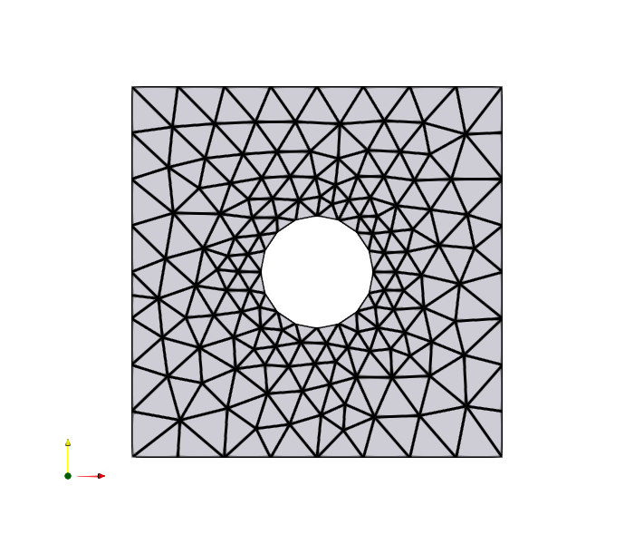<br><b>hier_triangle_circle, level 0</b> | 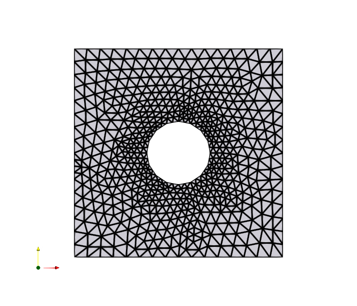<br><b>level 1</b> | 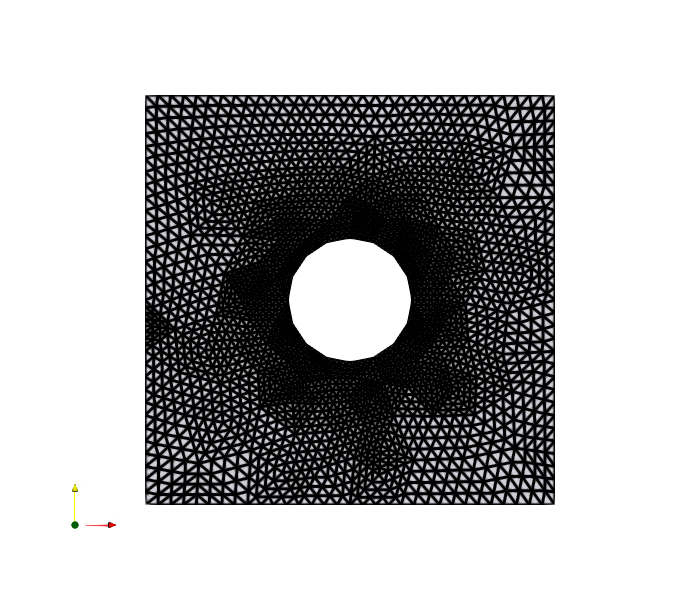<br><b>level 2</b> |
| 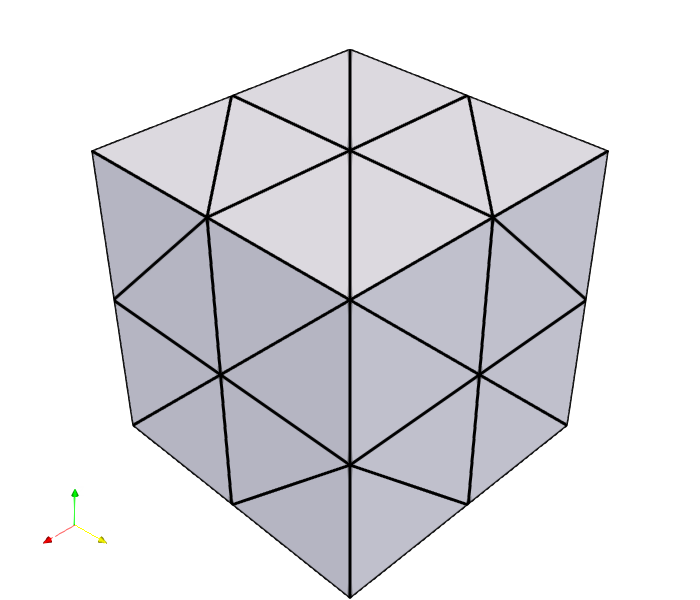<br><b>hier_kuhn, level 0</b> | 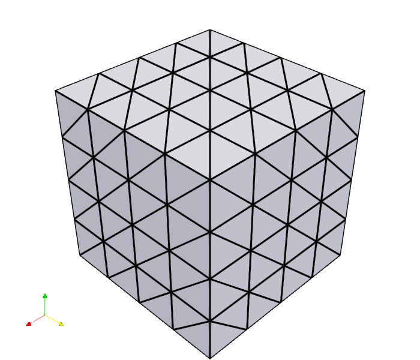<br><b>level 1</b> | 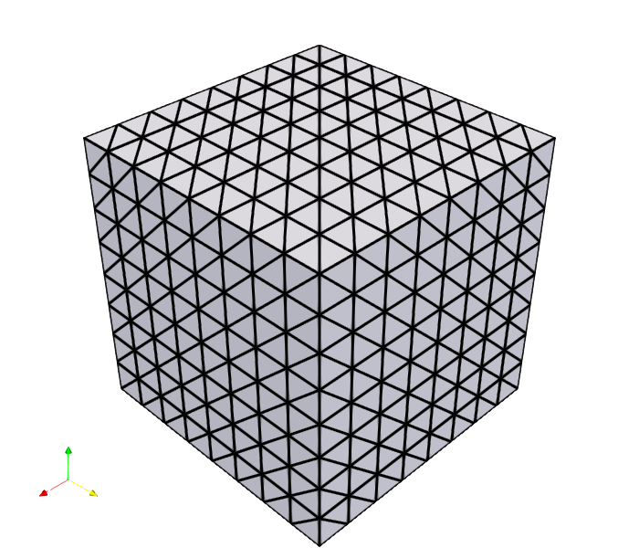<br><b>level 2</b> |
| 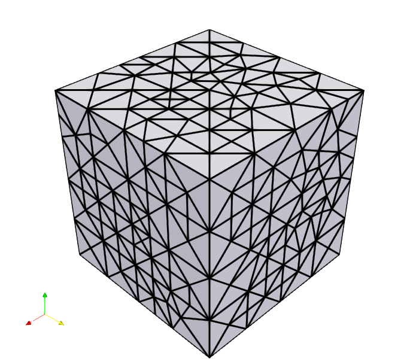<br><b>hier_tetra_sphere, level 0</b> | 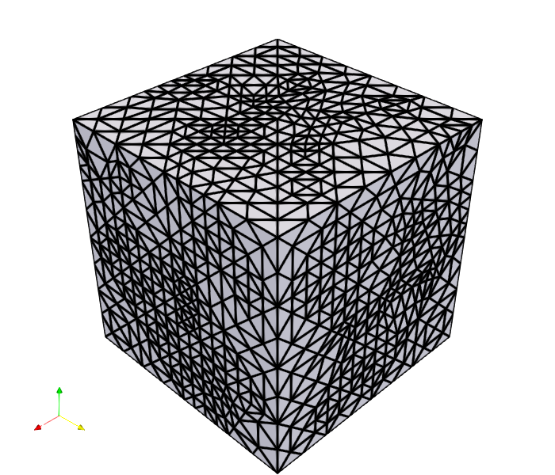<br><b>level 1</b> | 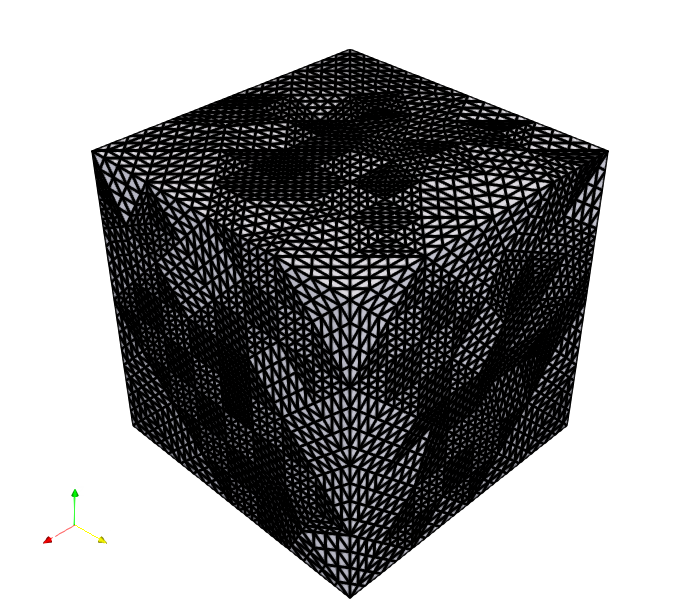<br><b>level 2</b> |
| 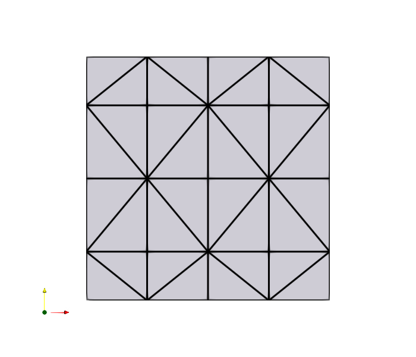<br><b>hier_gridsplit_stretched, level 0</b> | 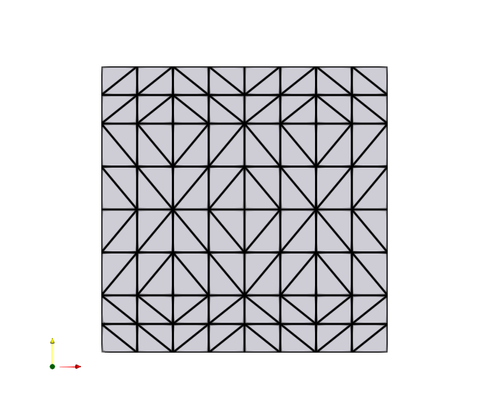<br><b>level 1</b> | 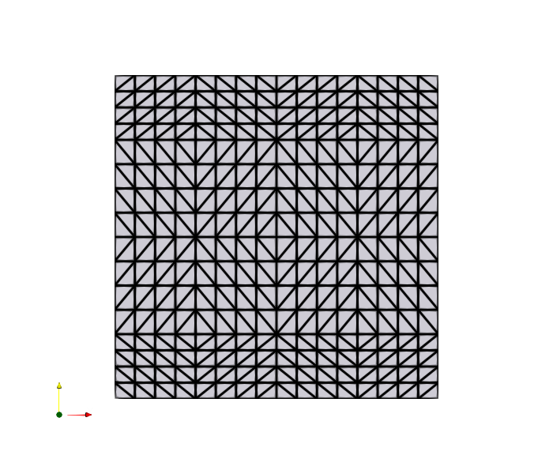<br><b>level 2</b> |

`hier_gridsplit_stretched` has 4 levels. Its level 3 image is `hier_gridsplit_stretched_L3.png`.

## Known limitations of `writer.py`

Status: documented on 2026-11-12. These problems are not fixed. The work now focuses on `writer.jl`. `writer.py` is unchanged.

### 1. Slivers in `tetra` meshes

`writer.py` calls TetGen with the options `pqe` and does not improve the mesh afterwards. The meshes keep slivers.
I ran `writer.py` on 9 box configs (with and without a sphere) of 1,310 to 23,441 cells and ran `writer.jl` on 9 comparable configs.
The numbers come from `tools/quality_stats.py`.

| | Smallest dihedral angle | Cells below 10 degrees | Largest dihedral angle |
|---|---|---|---|
| `writer.py` | 1.6 to 6.3 degrees | 1 to 53 per mesh (0.1 to 0.5 percent) | up to 176.9 degrees |
| `writer.jl` with `min_dihedral: 0` | 0.6 to 6.9 degrees | 10 to 67 per mesh (0.2 to 0.75 percent) | up to 179.1 degrees |
| `writer.jl`, default | 10.06 to 10.79 degrees | none | 161 to 164.7 degrees |

The same box therefore gets a different mesh quality from the two writers. The attributes `min_dihedral_deg`, `max_dihedral_deg` and `max_radius_edge_ratio` in the HDF5 file show the effect.
An idea that I did not test: TetGen may accept a minimum dihedral angle in its `q` switch (from memory, not verified).

### 2. Periodic `tetra` meshes are not periodic

With `periodic: [true, true, true]` and `mesh_type: tetra`, `writer.py` prints warnings such as `periodic_x: 45 lo vs 48 hi vertices`.
The opposite faces then have different vertex sets, so the pairs in `/periodicity` are incomplete.
The periodic and the non-periodic meshes of the same config had the same cell count and the same quality values. The request for periodicity had no effect on the mesh.
`writer.jl` makes matching faces. Its tests check them.
The likely cause is that TetGen refines the boundary of each face on its own. I did not verify this.
Do not use periodic `tetra` meshes from `writer.py` without a check of the pairs.

## Julia environment

`Project.toml` and `Manifest.toml` pin the Julia packages: YAML 0.4.17 and HDF5 0.17.4, with every package they need.
The Manifest was made with Julia 1.10.11. Run `julia --project=. -e 'import Pkg; Pkg.instantiate()'` once in this folder. It installs the exact versions.
In a clean Julia folder this took about 3 minutes. It needs a network. Without `--project=.`, Julia uses your global environment instead.

## Tests

`julia --project=. test_writer.jl [writer.jl]` runs the unit, config, end-to-end and gallery tests of `writer.jl`.
With `WRITER_REF_DIR=<folder>` it also compares the output with stored reference outputs bit by bit.
Make such a folder with `tools/run_writer_on_configs.sh writer.jl <folder>`. It holds 72 outputs: 47 plain meshes and 25 hierarchy levels. See `tools/README.md` for the other tools.

## Gallery

### Triangle

| | |
|---|---|
| 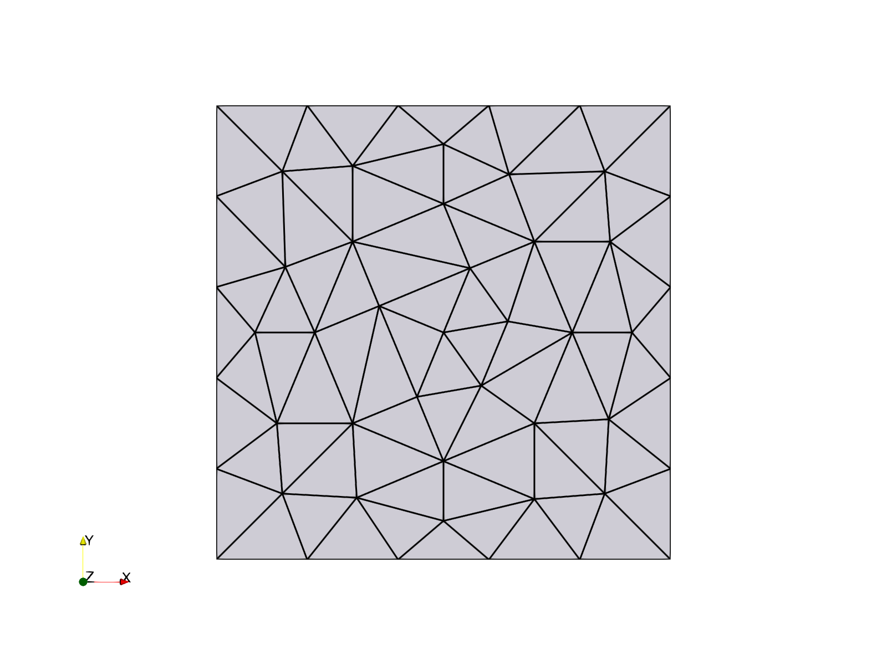<br><b><span style="font-size: 1.1em;">triangle_plain</span></b> | <br><b><span style="font-size: 1.1em;">triangle_circle</span></b> |
| <br><b><span style="font-size: 1.1em;">triangle_rectangle</span></b> | |

### Tetra

| | |
|---|---|
| <br><b><span style="font-size: 1.1em;">tetra_plain</span></b> | |

### Equilateral

| | |
|---|---|
| <br><b><span style="font-size: 1.1em;">equilateral_plain</span></b> | |

### Gridsplit

| | |
|---|---|
| 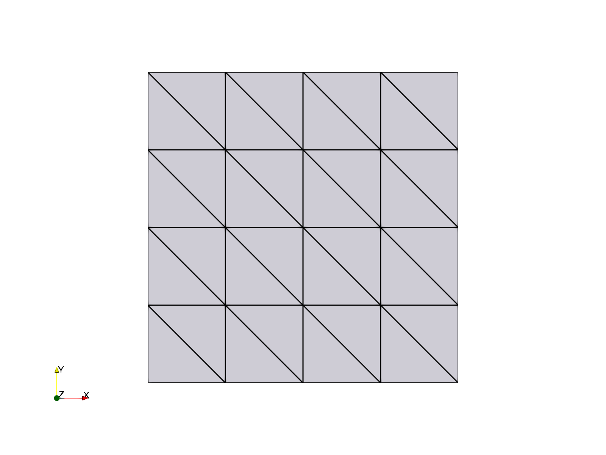<br><b><span style="font-size: 1.1em;">gridsplit_backslash</span></b> | <br><b><span style="font-size: 1.1em;">gridsplit_slash</span></b> |
| <br><b><span style="font-size: 1.1em;">gridsplit_alternate</span></b> | <br><b><span style="font-size: 1.1em;">gridsplit_stretched_onesided</span></b> |
| 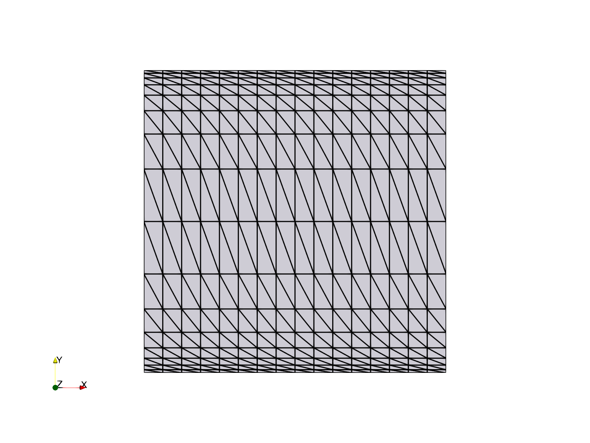<br><b><span style="font-size: 1.1em;">gridsplit_stretched_symmetric</span></b> | |

### Kuhn

| | |
|---|---|
| <br><b><span style="font-size: 1.1em;">kuhn_main</span></b> | <br><b><span style="font-size: 1.1em;">kuhn_flip_x</span></b> |
| 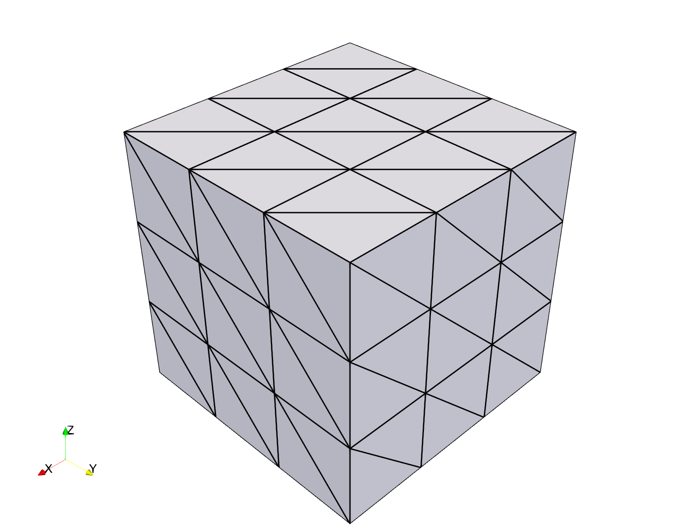<br><b><span style="font-size: 1.1em;">kuhn_flip_y</span></b> | <br><b><span style="font-size: 1.1em;">kuhn_flip_z</span></b> |
| <br><b><span style="font-size: 1.1em;">kuhn_alternate_layers</span></b> | <br><b><span style="font-size: 1.1em;">kuhn_stretched_onesided</span></b> |
| <br><b><span style="font-size: 1.1em;">kuhn_stretched_symmetric</span></b> | |

## Gallery (writer.jl)

The folder `gallery_julia/` holds the same cases for `writer.jl`: the YAML configs and the images that `render.py` makes from the files `writer.jl` writes.
The structured configs (`equilateral`, `gridsplit`, `kuhn`) are the same as in `gallery/`, and so are their meshes. The `triangle` and `tetra` configs use `mesh_options` (`mesh_size`) because `writer.jl` has its own mesher, so those meshes differ from the Python ones.

### Triangle

| | |
|---|---|
| 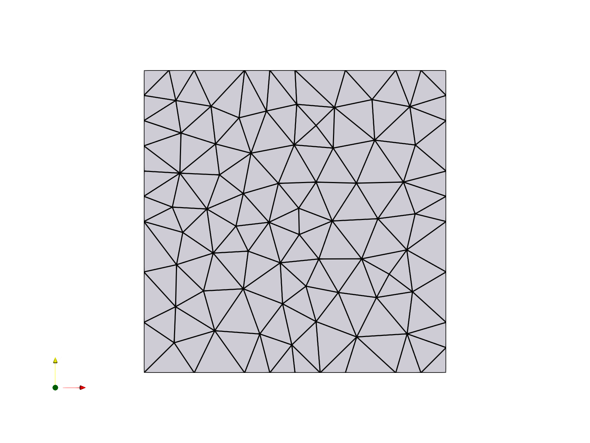<br><b><span style="font-size: 1.1em;">triangle_plain</span></b> | 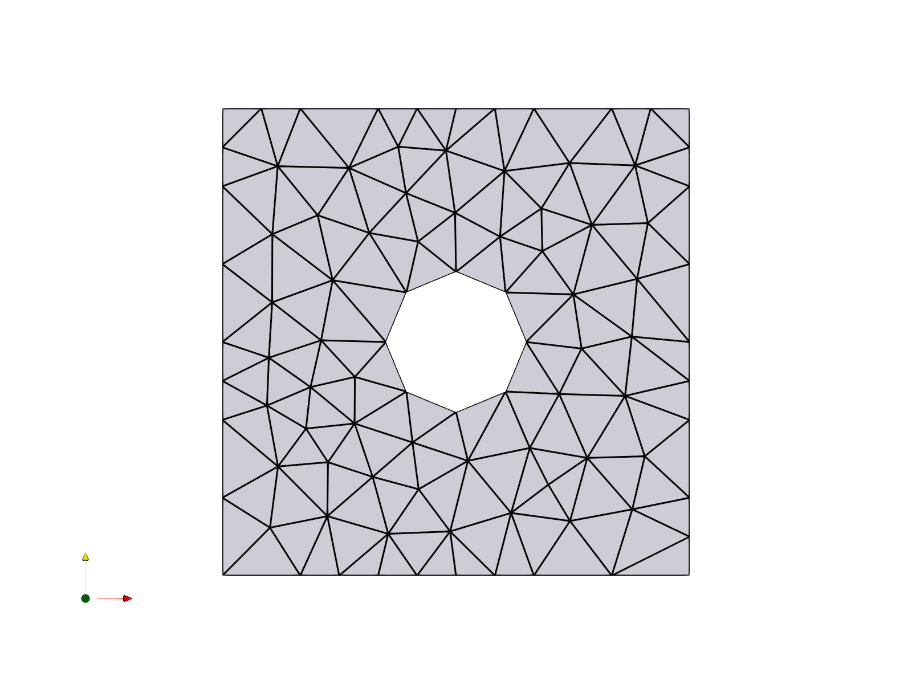<br><b><span style="font-size: 1.1em;">triangle_circle</span></b> |
| <br><b><span style="font-size: 1.1em;">triangle_rectangle</span></b> |  |

### Tetra

| | |
|---|---|
| 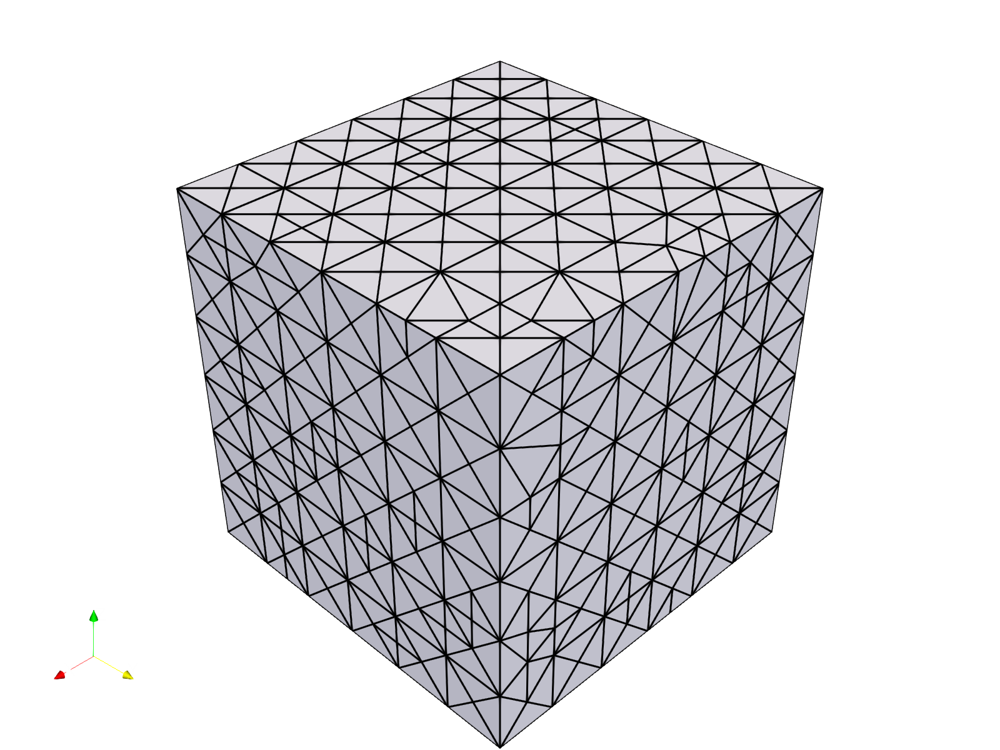<br><b><span style="font-size: 1.1em;">tetra_plain</span></b> |  |

### Equilateral

| | |
|---|---|
| <br><b><span style="font-size: 1.1em;">equilateral_plain</span></b> |  |

### Gridsplit

| | |
|---|---|
| 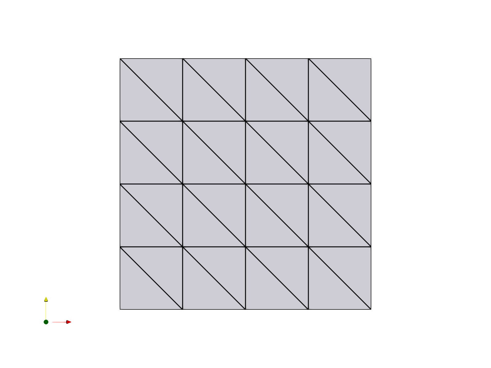<br><b><span style="font-size: 1.1em;">gridsplit_backslash</span></b> | 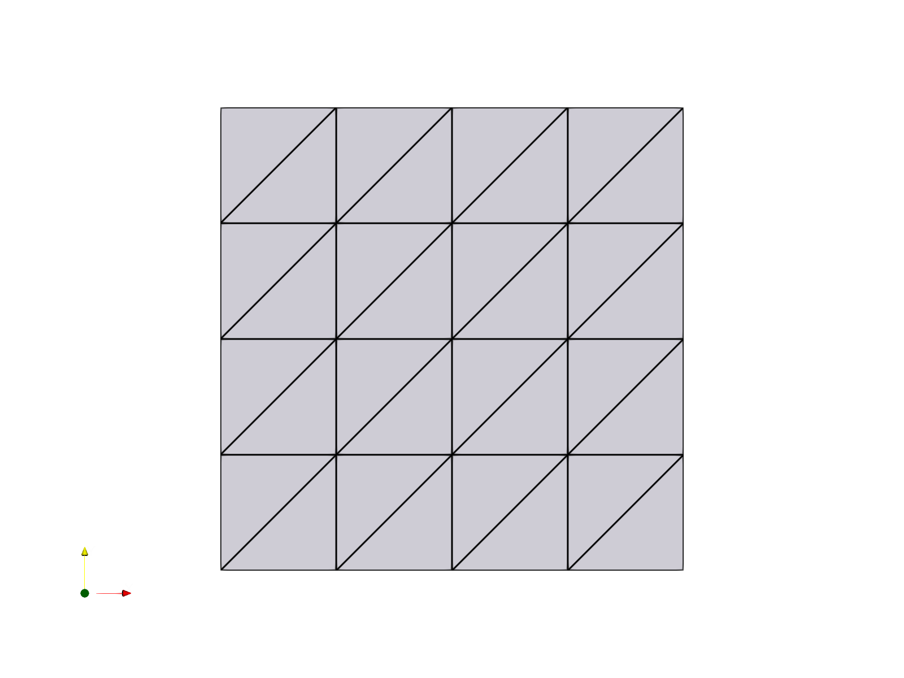<br><b><span style="font-size: 1.1em;">gridsplit_slash</span></b> |
| 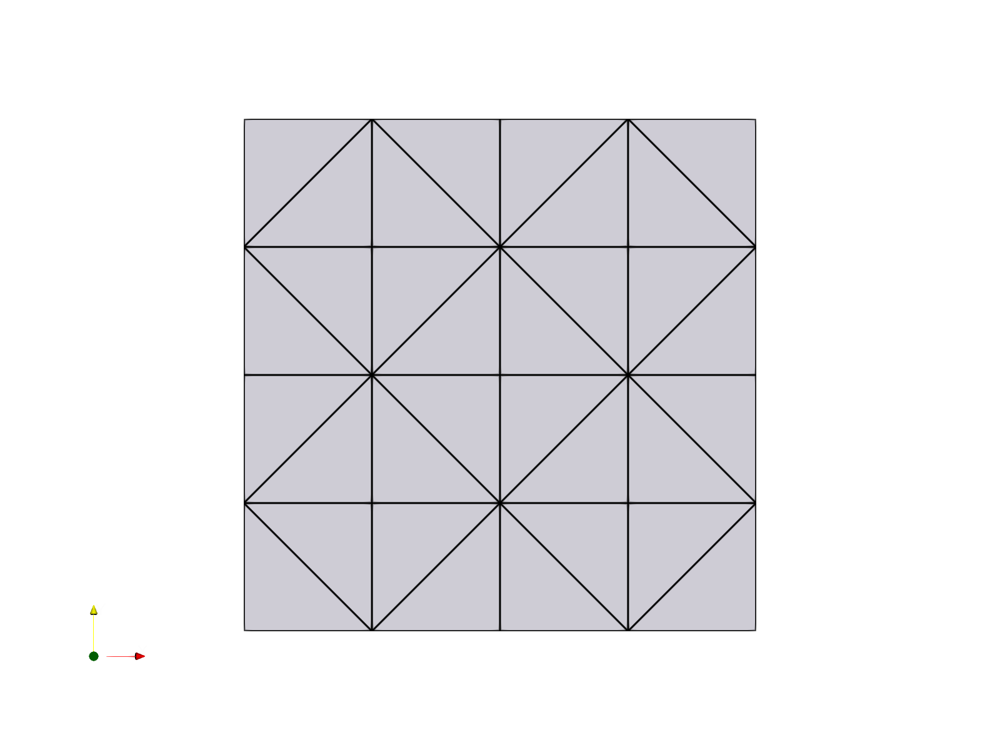<br><b><span style="font-size: 1.1em;">gridsplit_alternate</span></b> | <br><b><span style="font-size: 1.1em;">gridsplit_stretched_onesided</span></b> |
| <br><b><span style="font-size: 1.1em;">gridsplit_stretched_symmetric</span></b> |  |

### Kuhn

| | |
|---|---|
| 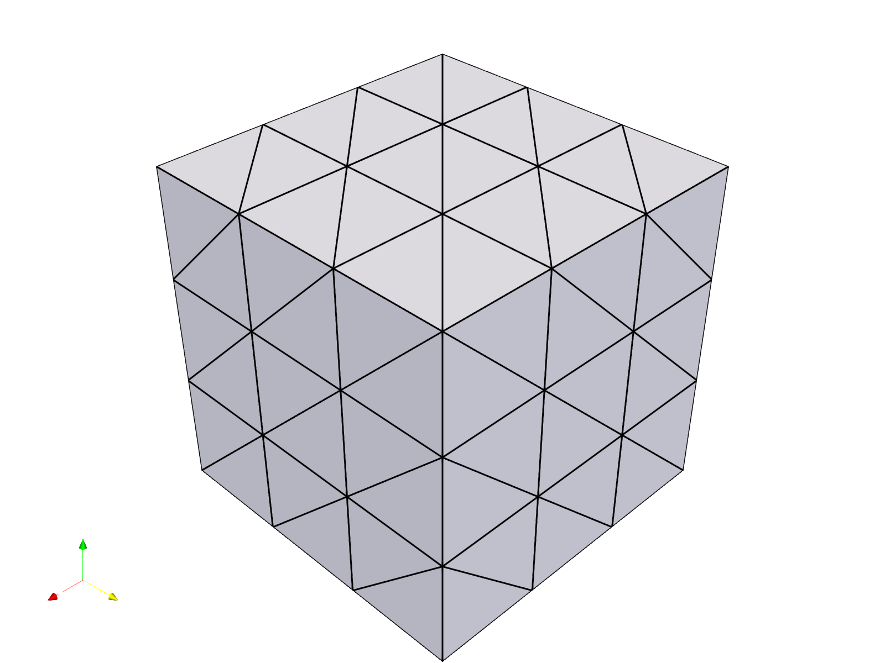<br><b><span style="font-size: 1.1em;">kuhn_main</span></b> | 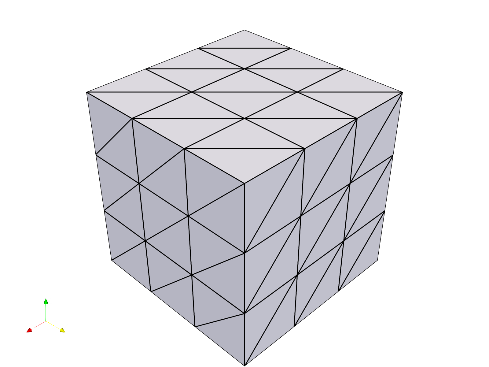<br><b><span style="font-size: 1.1em;">kuhn_flip_x</span></b> |
| 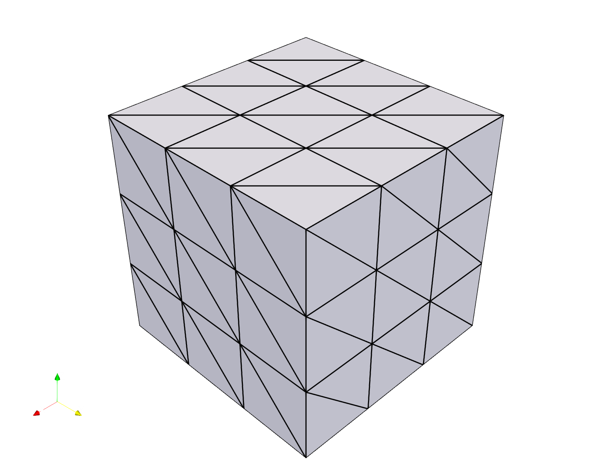<br><b><span style="font-size: 1.1em;">kuhn_flip_y</span></b> | <br><b><span style="font-size: 1.1em;">kuhn_flip_z</span></b> |
| <br><b><span style="font-size: 1.1em;">kuhn_alternate_layers</span></b> | 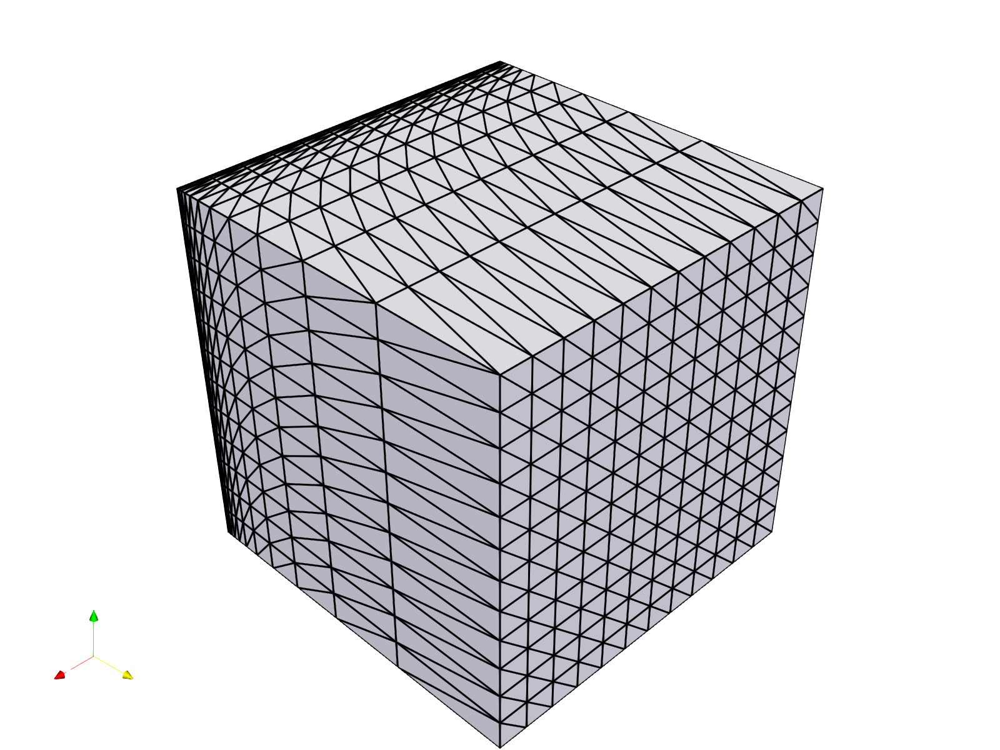<br><b><span style="font-size: 1.1em;">kuhn_stretched_onesided</span></b> |
| <br><b><span style="font-size: 1.1em;">kuhn_stretched_symmetric</span></b> |  |
