# unstructured-mesh-writer
A writer of 2D Triangular and 3D Tetrahedral unstructured meshes

Two writers produce the same HDF5/XDMF schema:

- `writer.py` (Python, MeshPy for `triangle` and `tetra`): `python writer.py config.yaml` or `python writer.py configs_dir/`.
- `writer.jl` (Julia, no mesher library; Delaunay refinement is built in): `julia writer.jl config.yaml` or `julia writer.jl configs_dir/`. It needs the packages YAML and HDF5.

Both write `<name>.h5` and `<name>.xdmf` next to the config. The mesh types are
`gridsplit`, `equilateral` (2-D), `kuhn` (3-D), `triangle` and `tetra` (Delaunay, with obstacles).
The header of each writer lists the config keys. The 2-D `diagonal` names are
`backslash` (default), `slash` and `alternate` in both writers.

## HDF5 schema

All matrices are row-major, with the shape (N, k) that XDMF, `h5py` and ParaView expect.
Connectivity is 0-based. In Julia, load a dataset with `_read_ds` to get the array back as `(N, k)`.

| Dataset | Shape | Content |
|---|---|---|
| `points` | (nVertices, 3) | Vertex coordinates (z is 0 in 2-D). |
| `cell_to_vertex` | (nCells, 3 or 4) | Vertices of each cell, positively oriented in 2-D. |
| `cell_to_edge` | (nCells, 3 or 6) | Edges of each cell. |
| `vertex_to_vertex` | (nEdges, 2) | Edge end vertices, smaller first. |
| `vertex_to_cell/offsets`, `.../indices` | (nVertices+1), (nIndices) | Cells around each vertex, in CSR form. |
| `cell_vol`, `vertex_vol` | (nCells), (nVertices) | Cell and dual vertex measures. |
| `cell_vertex_normal` | (nCells, dim+1, 3) | Per cell and local vertex, the area vector of the face opposite that vertex. Not summed onto global vertices. |
| `boundary/point_markers` | (nVertices) | Box side or obstacle marker, 0 inside. |
| `boundary/edge_markers` | (nEdges) | The same for edges; 2-D only. |
| `periodicity/*_pairs`, `all_pairs` | (nPairs, 2) | Periodic vertex pairs; only for periodic axes. |

Attributes: `schema_version` (1: row-major matrices, 0-based connectivity; it increases when a layout or a meaning changes), `mesh_type` (`triangle` for every 2-D mesh, `tetra` for every 3-D mesh), `dimension`,
`box_length`, `n_vertices`, `n_cells`, `n_edges`.

Quality attributes (floats, angles in degrees; both writers compute them the same way and log them):

| Mesh | Attributes |
|---|---|
| 2-D | `min_angle_deg`, `max_angle_deg`: the smallest and the largest interior angle of the triangles |
| 3-D | `min_dihedral_deg`, `max_dihedral_deg`: the smallest and the largest dihedral angle of the tetrahedra; `max_radius_edge_ratio`: the largest ratio of circumradius to shortest edge (0.612 for a regular tetrahedron) |

Adding attributes does not change `schema_version`.

### Sliver removal in `writer.jl` (`tetra` only)

After the Delaunay refinement, `writer.jl` flips faces and edges around the cells whose smallest dihedral angle is below the goal.
A flip changes the connectivity of 2 or 3 cells and moves no vertex. The boundary, the markers and the periodic pairs do not change.
The key `mesh_options: min_dihedral` sets the goal in degrees. The default is 10.0. The value 0 turns the flips off.
The goal is not a guarantee. The log lists, for each pass, the flips done and the candidates rejected, and the number of cells below the goal before and after.
A flip is kept only when the new cells fill the same space with a positive volume, the smallest dihedral angle rises by at least 1 degree,
and the radius-edge ratio stays within the larger of the old ratio and `radius_edge_bound`. The smoothing sweeps run after the flips.
In the 10 reference `tetra` meshes the number of cells below 10 degrees fell from 210 to 4. `writer.py` has no such step.

## Tests

`julia test_writer.jl [writer.jl]` runs the unit, config, end-to-end and gallery tests of `writer.jl`.
With `WRITER_REF_DIR=<folder>` it also compares the output with stored reference outputs bit by bit.
Make such a folder with `tools/run_writer_on_configs.sh writer.jl <folder>`. See `tools/README.md` for the other tools.

## Gallery

### Triangle

| | |
|---|---|
|  <b>triangle_plain</b> |  <b>triangle_circle</b> |
|  <b>triangle_rectangle</b> | |

### Tetra

| | |
|---|---|
| 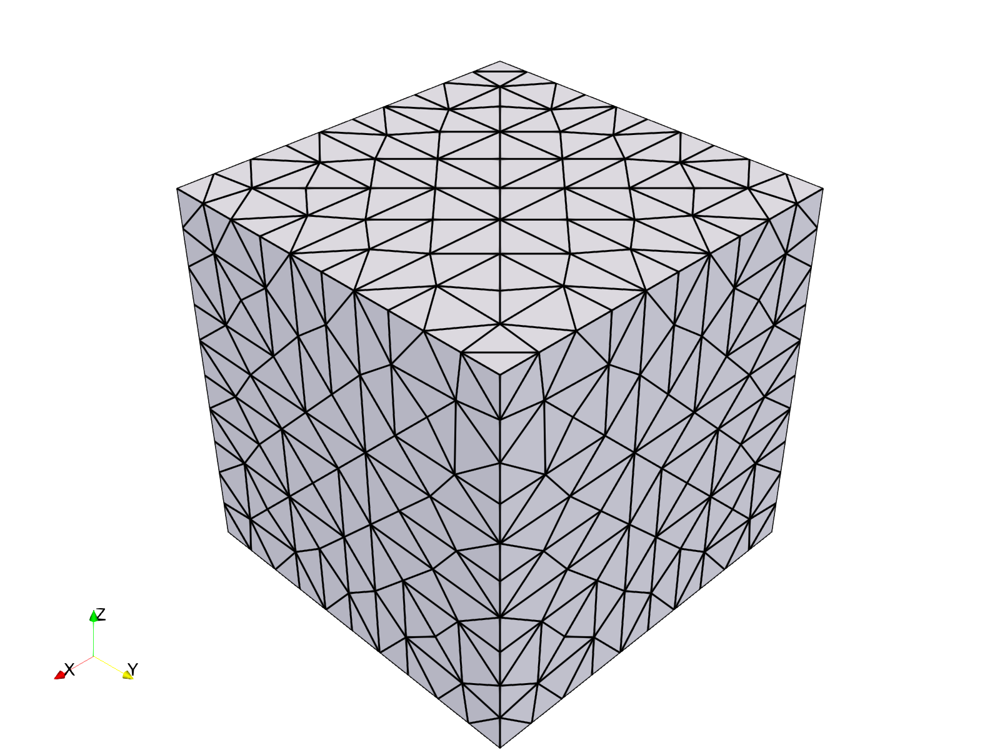 <b>tetra_plain</b> | |

### Equilateral

| | |
|---|---|
| 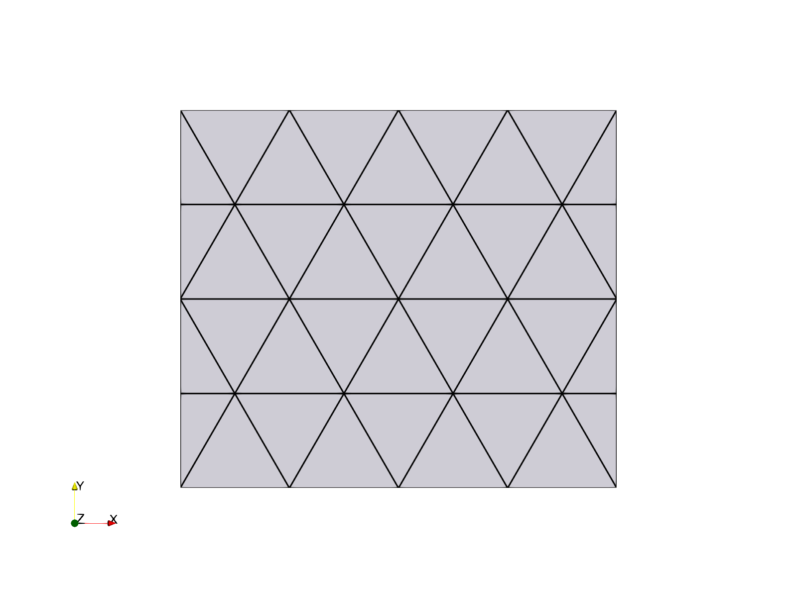 <b>equilateral_plain</b> | |

### Gridsplit

| | |
|---|---|
|  <b>gridsplit_backslash</b> |  <b>gridsplit_slash</b> |
|  <b>gridsplit_alternate</b> |  <b>gridsplit_stretched_onesided</b> |
|  <b>gridsplit_stretched_symmetric</b> | |

### Kuhn

| | |
|---|---|
| 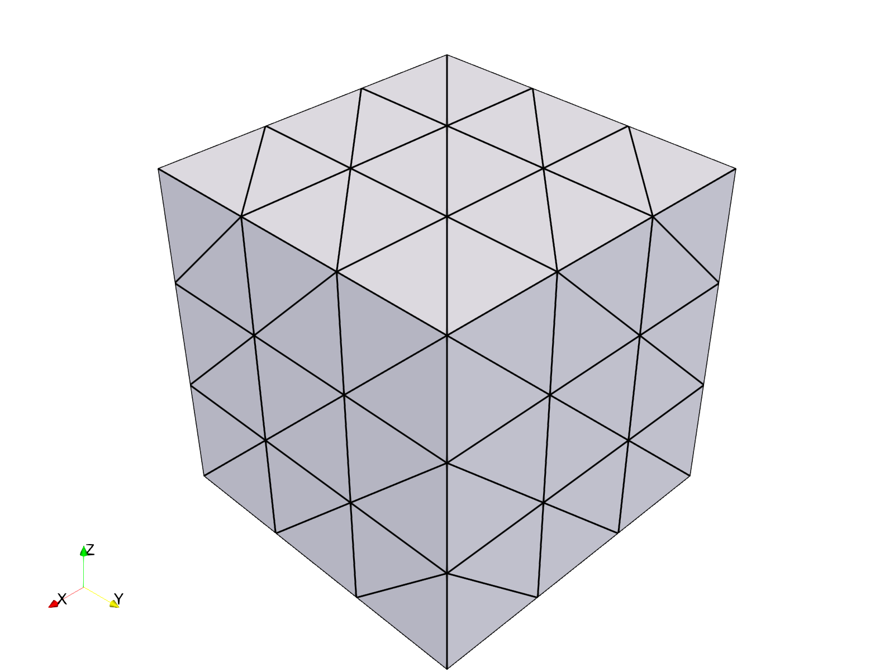 <b>kuhn_main</b> | 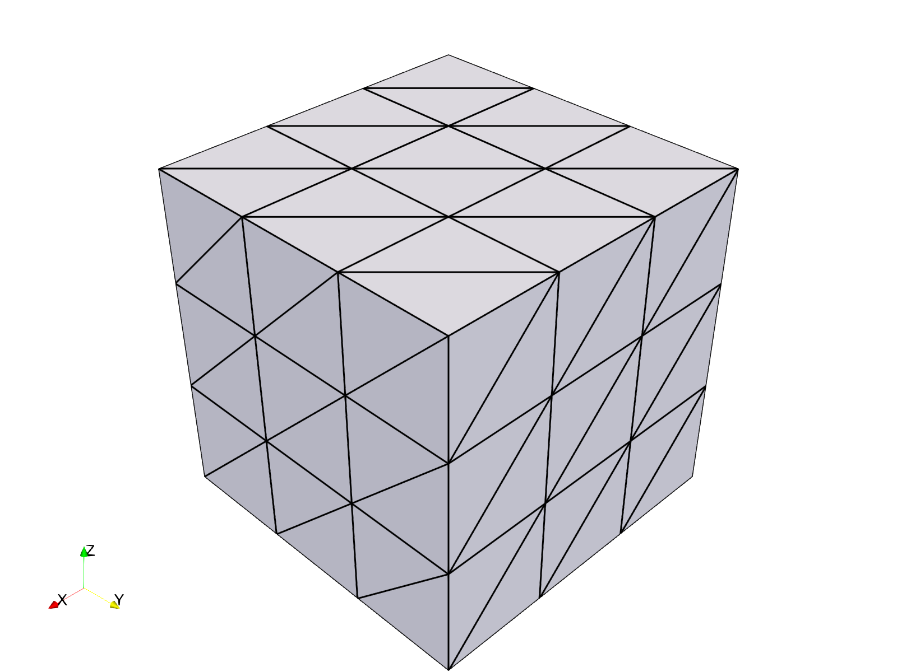 <b>kuhn_flip_x</b> |
|  <b>kuhn_flip_y</b> |  <b>kuhn_flip_z</b> |
| 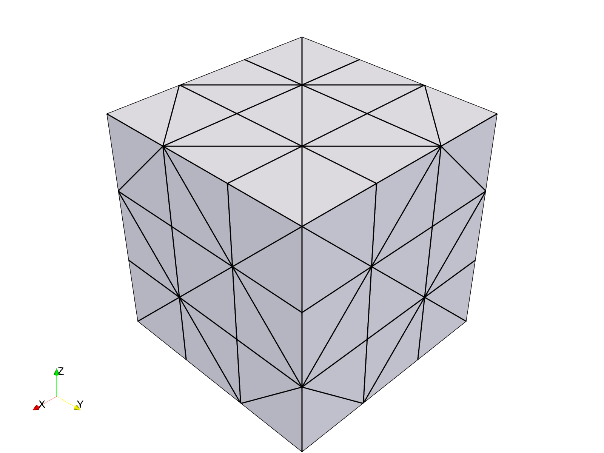 <b>kuhn_alternate_layers</b> |  <b>kuhn_stretched_onesided</b> |
| 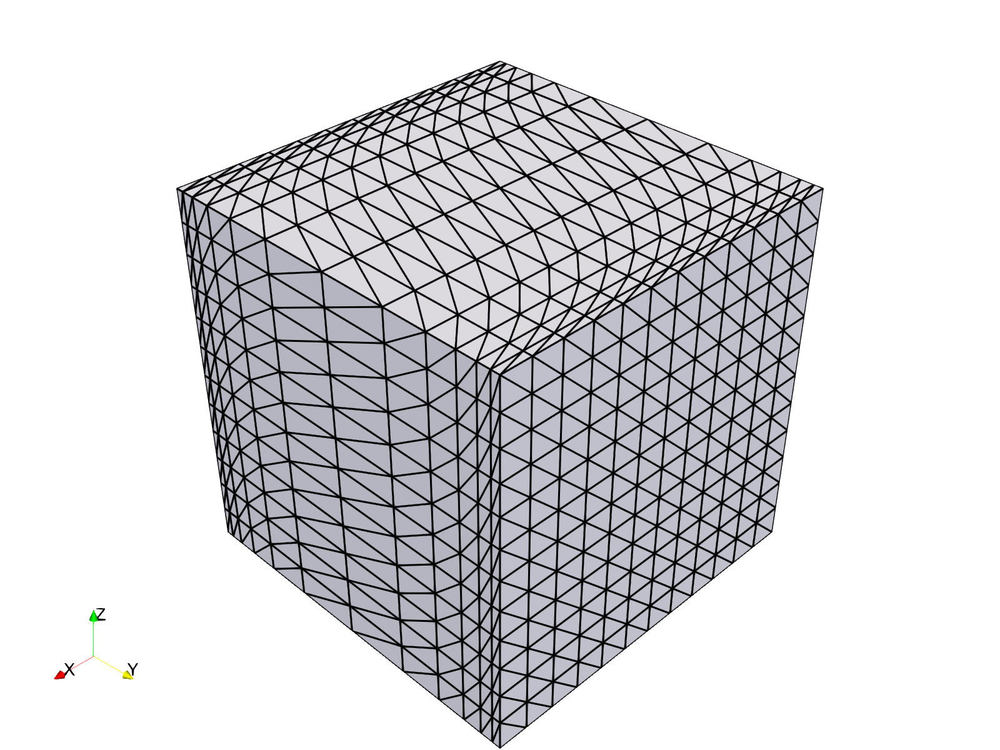 <b>kuhn_stretched_symmetric</b> | |

## Gallery (writer.jl)

The folder `gallery_julia/` holds the same cases for `writer.jl`: the YAML configs and the images that `render.py` makes from the files `writer.jl` writes.
The structured configs (`equilateral`, `gridsplit`, `kuhn`) are the same as in `gallery/`, and so are their meshes. The `triangle` and `tetra` configs use `mesh_options` (`mesh_size`) because `writer.jl` has its own mesher, so those meshes differ from the Python ones.

### Triangle

| | |
|---|---|
|  <b>triangle_plain</b> |  <b>triangle_circle</b> |
| 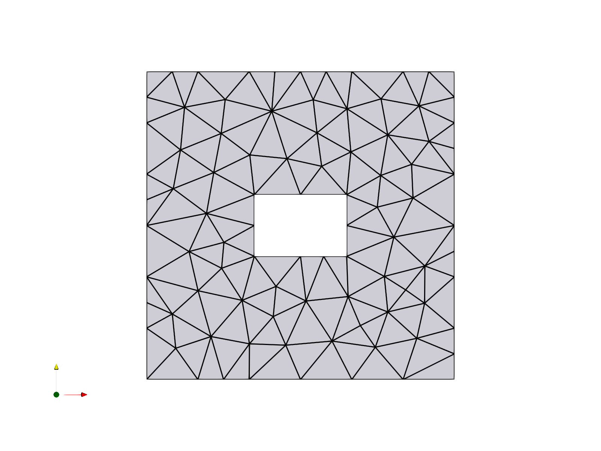 <b>triangle_rectangle</b> |  |

### Tetra

| | |
|---|---|
|  <b>tetra_plain</b> |  |

### Equilateral

| | |
|---|---|
| 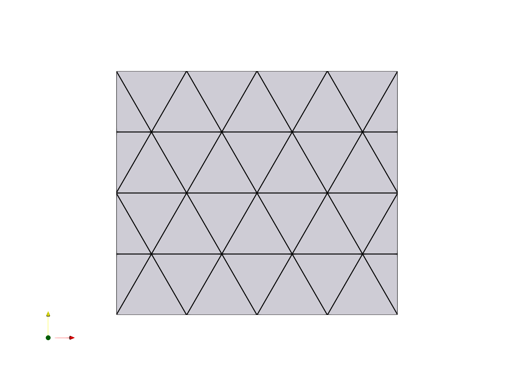 <b>equilateral_plain</b> |  |

### Gridsplit

| | |
|---|---|
|  <b>gridsplit_backslash</b> |  <b>gridsplit_slash</b> |
|  <b>gridsplit_alternate</b> | 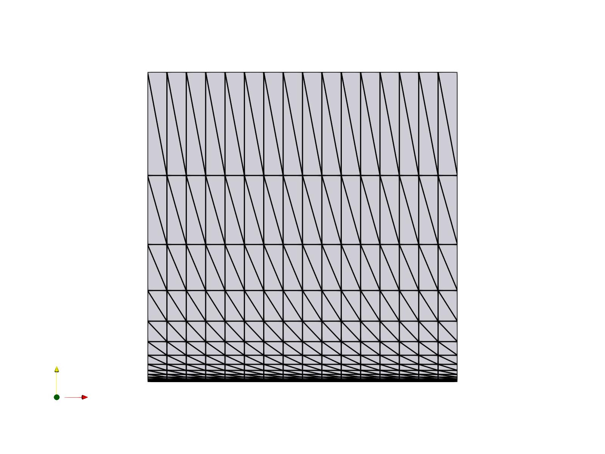 <b>gridsplit_stretched_onesided</b> |
| 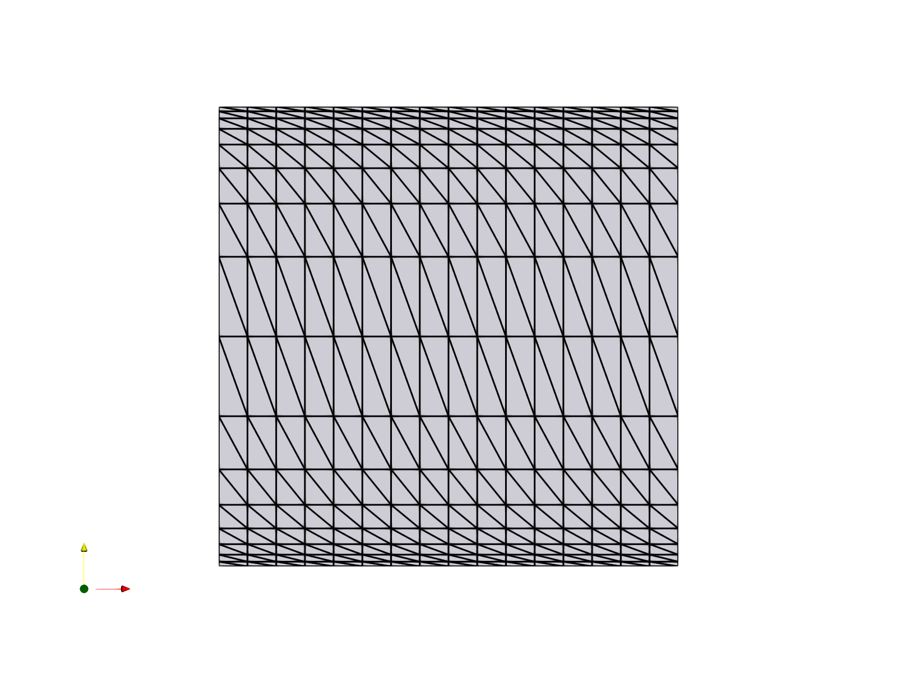 <b>gridsplit_stretched_symmetric</b> |  |

### Kuhn

| | |
|---|---|
|  <b>kuhn_main</b> |  <b>kuhn_flip_x</b> |
|  <b>kuhn_flip_y</b> |  <b>kuhn_flip_z</b> |
| 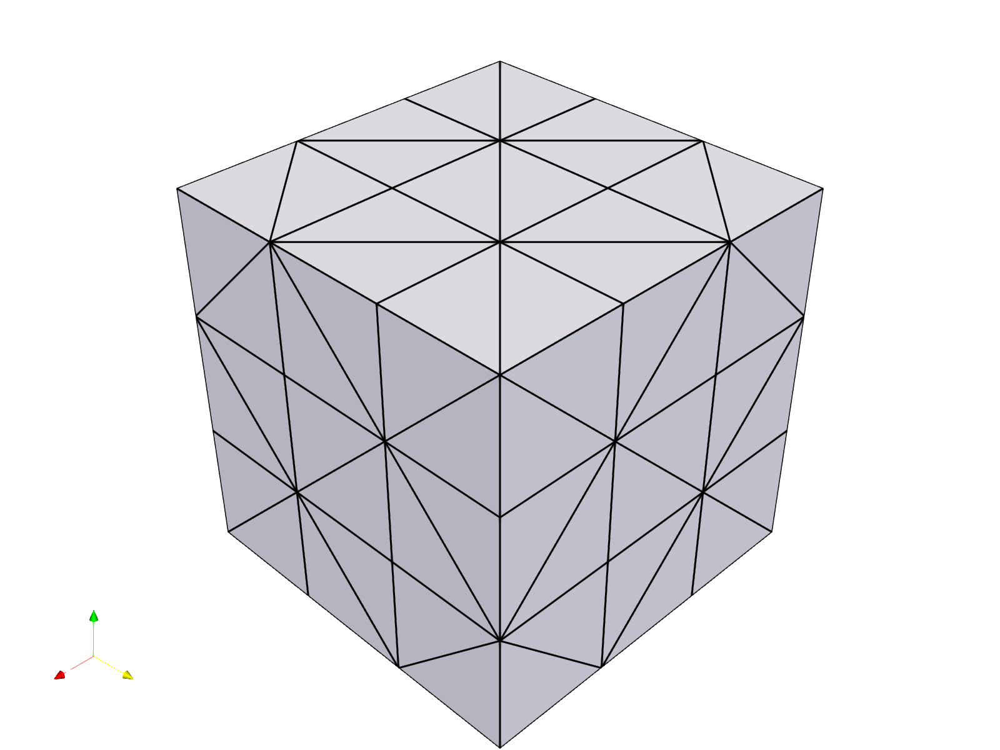 <b>kuhn_alternate_layers</b> |  <b>kuhn_stretched_onesided</b> |
|  <b>kuhn_stretched_symmetric</b> |  |
